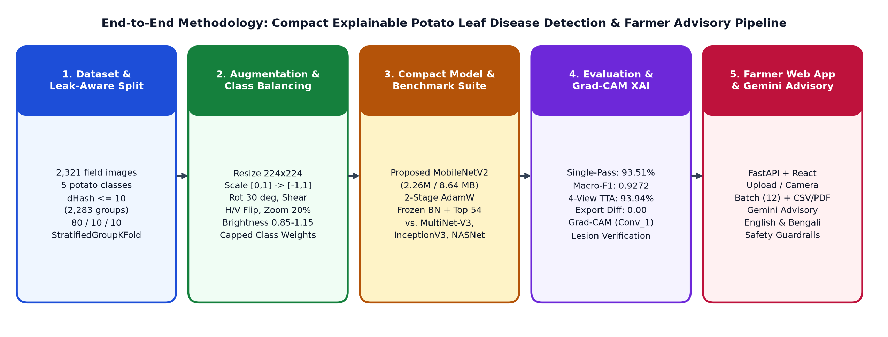
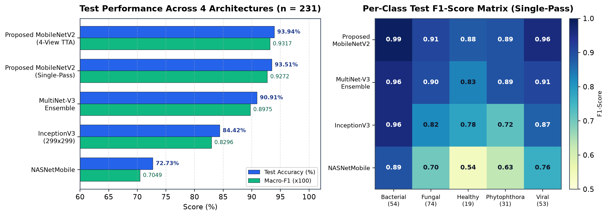
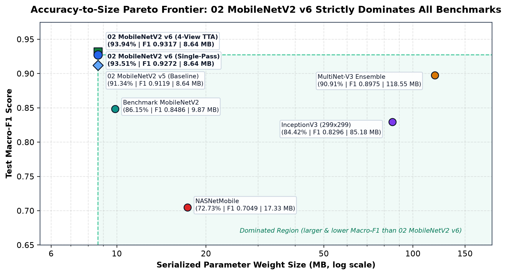
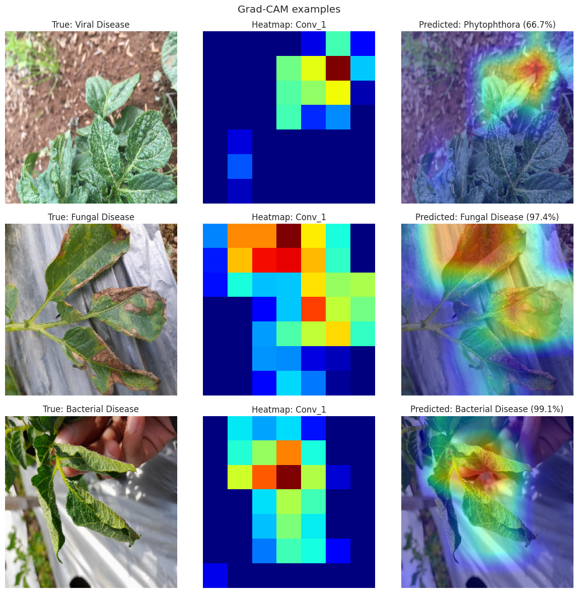

# Explainable Deep Learning Based Potato Leaf Disease Detection and Intelligent Advisory System

> **B.Sc. in Computer Science and Engineering — Capstone Project**
> Department of Computer Science and Engineering, **Bangladesh University of Business and Technology (BUBT)** • November 2026

[](https://potato.mamunlab.com/)
[](#published-kaggle-notebooks--dataset)
[](https://www.tensorflow.org/)
[](https://keras.io/)
[-2563eb?style=flat-square)](#experimental-results--benchmarks)
[](#experimental-results--benchmarks)
[-7c3aed?style=flat-square)](#explainable-ai-grad-cam-gemini-advisory--web-application)

An end-to-end **accurate, compact, and explainable** agricultural AI system for detecting potato leaf diseases from uncontrolled outdoor field photographs and translating model predictions into actionable, safety-constrained farmer guidance in **English and Bengali**.

The system centers on a fine-tuned **8.64 MB MobileNetV2** classifier (`2,264,389` parameters) trained under a **perceptual-hash leak-aware** evaluation protocol, paired with **Grad-CAM** visual explanations, a **Google Gemini** advisory pipeline, and a live **FastAPI + React** web application at **[potato.mamunlab.com](https://potato.mamunlab.com/)**.

---

## Table of Contents

- [Key Highlights](#key-highlights)
- [Quick Links to Deliverables](#quick-links-to-deliverables)
- [Published Kaggle Notebooks & Dataset](#published-kaggle-notebooks--dataset)
- [Project Phases (`01/` vs. `02/`)](#project-phases-01-vs-02)
- [Repository Structure](#repository-structure)
- [System Architecture & Methodology (`02/`)](#system-architecture--methodology-02)
  - [1. Leak-Aware Dataset Contract](#1-leak-aware-dataset-contract)
  - [2. Proposed Compact MobileNetV2 & Fine-Tuning Recipe](#2-proposed-compact-mobilenetv2--fine-tuning-recipe)
  - [3. Comparative Benchmark Architectures](#3-comparative-benchmark-architectures)
- [Experimental Results & Benchmarks](#experimental-results--benchmarks)
  - [Master Accuracy-to-Size Pareto Comparison (`02/`)](#master-accuracy-to-size-pareto-comparison-02)
  - [Zero-Size-Cost Fine-Tuning Ablation](#zero-size-cost-fine-tuning-ablation)
  - [Per-Class Test F1-Score Across Architectures](#per-class-test-f1-score-across-architectures)
  - [Phase `01/` CPU-Only Baseline Summary](#phase-01-cpu-only-baseline-summary)
- [Explainable AI (Grad-CAM), Gemini Advisory & Web Application](#explainable-ai-grad-cam-gemini-advisory--web-application)
- [Reproducing the Experiments](#reproducing-the-experiments)
- [Compiling the LaTeX Thesis Reports](#compiling-the-latex-thesis-reports)
- [Limitations & Future Work](#limitations--future-work)
- [Team & Supervision](#team--supervision)
- [Citation & References](#citation--references)

---

## Key Highlights

- **Strict Accuracy-to-Size Pareto Dominance:** At **8.64 MB** (`2.26M` params), Proposed MobileNetV2 achieves **93.51% single-pass test accuracy** (`0.9272` macro-F1, `0.4466` test loss) and **93.94% accuracy** (`0.9317` macro-F1) with zero-parameter **4-view Test-Time Augmentation (TTA)**—beating the **13.7x larger** MultiNet-V3 ensemble (`118.55 MB`, `90.91%`), InceptionV3 (`85.18 MB`, `84.42%`), and NASNetMobile (`17.33 MB`, `72.73%`) on the exact same unseen test split.
- **Zero-Leakage Evaluation Protocol:** Near-duplicate field photographs are clustered via 64-bit perceptual difference hashing (`dHash <= 10`, yielding `2,283` unique groups out of `2,321` images) prior to an 80:10:10 `StratifiedGroupKFold` split (`1,859` train / `231` val / `231` test), guaranteeing zero leaf leakage across subsets.
- **Eliminated Fine-Tuning Shock:** Restoring the best Stage-1 head checkpoint and freezing all `BatchNormalization` layers while unfreezing the top 54 layers under `AdamW` lifted single-pass accuracy by **+2.17 percentage points** (`91.34% -> 93.51%`) and cut test loss by **33.6%** (`0.6727 -> 0.4466`) with zero added parameters.
- **Verified Serving Integrity:** Reloading every exported native `.keras` artifact outside `tf.distribute.MirroredStrategy` verified **$0.00 \times 10^{0}$ maximum probability discrepancy** across all four architectures.
- **Lesion-Grounded Explainability (Grad-CAM):** Visual attention heatmaps from `Conv_1` confirm predictions localize on foliar lesions, blight margins, and chlorotic mottling rather than background soil or plastic mulch.
- **Live Bilingual Farmer Web App:** Deployed at **[https://potato.mamunlab.com/](https://potato.mamunlab.com/)** with drag-and-drop & smartphone camera capture, Grad-CAM attention overlay, PDF report export, 12-image batch screening with CSV export, English/Bengali UI & Light/Dark themes, and safety-guarded Google Gemini (`gemini-3.1-flash-lite`) chat.

---

## Quick Links to Deliverables

| Deliverable | Final System (`02/`) | Initial Baseline (`01/`) |
| :--- | :--- | :--- |
| **Compiled Thesis Report (PDF)** | [`02/latex_report/main.pdf`](02/latex_report/main.pdf) *(81 pages)* | [`01/latex_report/main.pdf`](01/latex_report/main.pdf) *(87 pages)* |
| **LaTeX Source** | [`02/latex_report/main.tex`](02/latex_report/main.tex) | [`01/latex_report/main.tex`](01/latex_report/main.tex) |
| **Defense Presentation (PDF / PPTX)** | [`Potato_Leaf_Disease_Defense_Slides.pdf`](02/presentation/Potato_Leaf_Disease_Defense_Slides.pdf) • [`.pptx`](02/presentation/Potato_Leaf_Disease_Defense_Slides.pptx) *(35 slides)* | [`Potato_Leaf_Disease_Defense_Slides.pptx`](01/presentation/Potato_Leaf_Disease_Defense_Slides.pptx) *(40 slides)* |
| **Primary Experiment Notebook** | [`explainable-cnn-potato-leaf-disease-detection-02.ipynb`](02/explainable-cnn-potato-leaf-disease-detection-02.ipynb) | [`explainable-cnn-potato-leaf-disease-detection-01.ipynb`](01/explainable-cnn-potato-leaf-disease-detection-01.ipynb) |
| **Benchmark Notebooks** | [`02/benchmark_models/`](02/benchmark_models/) *(MultiNet-V3, InceptionV3, NASNetMobile)* | Included in `01` notebook *(Custom CNN, ResNet50, MobileNetV2)* |
| **Kaggle Dataset & Runs** | [Dataset](https://www.kaggle.com/datasets/mamunonweb/potato-disease-dataset-03) • [All Rendered Runs](#published-kaggle-notebooks--dataset) | Included with outputs inside `01` `.ipynb` |
| **Live Deployed Web App** | **[https://potato.mamunlab.com/](https://potato.mamunlab.com/)** | — |

---

## Published Kaggle Notebooks & Dataset

The `02/` notebooks in this repository are stored clean (without embedded cell outputs); the full rendered dual-T4 GPU execution logs, training curves, confusion matrices, Grad-CAM plots, and export integrity checks are published on Kaggle:

| Resource | Local Notebook | Published Kaggle Link | Key Test Result (`N = 231`) |
| :--- | :--- | :--- | :--- |
| **Curated 5-Class Dataset** | `potato-disease-dataset-03` | [kaggle.com/datasets/mamunonweb/potato-disease-dataset-03](https://www.kaggle.com/datasets/mamunonweb/potato-disease-dataset-03) | 2,321 images (2,283 `dHash <= 10` groups) |
| **Proposed MobileNetV2** | [`02/explainable-cnn-potato-leaf-disease-detection-02.ipynb`](02/explainable-cnn-potato-leaf-disease-detection-02.ipynb) | [kaggle.com/code/mamunonweb/explainable-cnn-potato-leaf-disease-detection](https://www.kaggle.com/code/mamunonweb/explainable-cnn-potato-leaf-disease-detection) | **93.51%** (`0.9272` F1) • **93.94%** TTA • `8.64 MB` |
| **MultiNet-V3 Ensemble** *(Benchmark)* | [`02/benchmark_models/multinet-v3.ipynb`](02/benchmark_models/multinet-v3.ipynb) | [kaggle.com/code/mamunonweb/multinet-v3-ensemble](https://www.kaggle.com/code/mamunonweb/multinet-v3-ensemble) | 90.91% (`0.8975` F1) • `118.55 MB` |
| **InceptionV3 (`299x299`)** *(Benchmark)* | [`02/benchmark_models/inception-v3.ipynb`](02/benchmark_models/inception-v3.ipynb) | [kaggle.com/code/mamunonweb/inceptionv3](https://www.kaggle.com/code/mamunonweb/inceptionv3) | 84.42% (`0.8296` F1) • `85.18 MB` |
| **NASNetMobile** *(Benchmark)* | [`02/benchmark_models/nasnetmobile.ipynb`](02/benchmark_models/nasnetmobile.ipynb) | [kaggle.com/code/mamunonweb/nasnetmobile](https://www.kaggle.com/code/mamunonweb/nasnetmobile) | 72.73% (`0.7049` F1) • `17.33 MB` |

---

## Project Phases (`01/` vs. `02/`)

This repository preserves both complete academic iterations so the engineering progression from diagnostic baseline to production-ready system is fully reproducible:

| Aspect | Phase `01/` — Initial Baseline Study | Phase `02/` — Final Optimized System |
| :--- | :--- | :--- |
| **Dataset** | 3,076 field images, **7 classes** (11:1 imbalance; includes 68-sample Nematode & Pest) | 2,321 curated field images (`potato-disease-dataset-03`), **5 core classes** (3.66:1 imbalance) |
| **Data Splitting** | Stratified 80:10:10 (`2,460 / 308 / 308`) | Perceptual-hash grouped (`dHash <= 10`, 2,283 groups) + `StratifiedGroupKFold` 80:10:10 (`1,859 / 231 / 231`) |
| **Hardware & Weights** | Kaggle CPU-only (CUDA unavailable), random init (`weights=None`), 6–10 epochs | Dual NVIDIA Tesla T4 GPUs (`MirroredStrategy`), ImageNet transfer learning + two-stage fine-tuning |
| **Primary Model** | Custom Lightweight CNN (`162,887` params, `1.98 MB`) | Fine-Tuned **MobileNetV2** (`2,264,389` params, `8.64 MB`, lean `6,405`-param head, frozen BN, AdamW) |
| **Benchmarks** | ResNet50 (`92.12 MB`), MobileNetV2 (`27.21 MB`) | MultiNet-V3 Ensemble (`118.55 MB`), InceptionV3 (`85.18 MB`), NASNetMobile (`17.33 MB`) |
| **Best Test Result** | 31.82% acc / `0.7688` micro-AUC (ResNet50; identified compute/weight bottlenecks) | **93.51% single-pass** (`0.9272` macro-F1) / **93.94% 4-view TTA** (`0.9317` macro-F1) |
| **XAI & Advisory** | Pipeline & Gemini safety guardrails verified end-to-end | Verified lesion-grounded Grad-CAM (`Conv_1`) + live FastAPI/React + bilingual Gemini app |

---

## Repository Structure

```text
capstone/
├── .gitignore
├── README.md
├── 01/                                                  # Phase 01: 7-class CPU baseline study
│   ├── explainable-cnn-potato-leaf-disease-detection-01.ipynb
│   ├── latex_report/                                    # BUBT V4 LaTeX thesis report (87 pages)
│   │   ├── main.tex                                     # Master LaTeX entry point (IEEE biblatex/biber)
│   │   ├── main.pdf                                     # Compiled PDF report
│   │   ├── cover_page.tex, Abstract.tex, Acronyms.tex, ...
│   │   ├── chapter1.tex ... chapter6.tex                # Chapters 1–6
│   │   ├── ref.bib                                      # Verified IEEE references
│   │   ├── AI Report.png, Similarity Score.png
│   │   └── image/                                       # Report figures & web app screenshots
│   └── presentation/
│       └── Potato_Leaf_Disease_Defense_Slides.pptx      # 40-slide defense deck
└── 02/                                                  # Phase 02: Final 5-class GPU system & benchmarks
    ├── explainable-cnn-potato-leaf-disease-detection-02.ipynb   # Proposed 8.64 MB MobileNetV2 notebook
    ├── benchmark_models/                                # Identical-split comparative benchmarks
    │   ├── multinet-v3.ipynb                            # EfficientNetB0 + MobileNetV2 + ResNet50 (118.55 MB)
    │   ├── inception-v3.ipynb                           # InceptionV3 299x299 (85.18 MB)
    │   └── nasnetmobile.ipynb                           # NASNetMobile (17.33 MB)
    ├── latex_report/                                    # BUBT V4 LaTeX thesis report (81 pages)
    │   ├── main.tex                                     # Master LaTeX entry point (IEEE biblatex/biber)
    │   ├── main.pdf                                     # Compiled PDF report
    │   ├── cover_page.tex, Abstract.tex, Acronyms.tex, ...
    │   ├── chapter1.tex ... chapter6.tex                # Chapters 1–6
    │   ├── ref.bib                                      # Verified IEEE references
    │   ├── AI Report.png, Similarity Score.png
    │   └── image/                                       # Training curves, CMs, Pareto plot, Grad-CAM, UI
    └── presentation/
        ├── Potato_Leaf_Disease_Defense_Slides.pptx      # 35-slide defense deck
        └── Potato_Leaf_Disease_Defense_Slides.pdf       # Exported PDF defense deck
```

> **Note:** Local historical drafts in `archive/` and intermediate LaTeX build artifacts (`*.aux`, `*.bbl`, `*.log`, `*.toc`, etc.) are excluded via [`.gitignore`](.gitignore), while both compiled thesis PDFs (`01/latex_report/main.pdf` and `02/latex_report/main.pdf`) are tracked directly in Git.

---

## System Architecture & Methodology (`02/`)

<p align="center">
  
</p>

### 1. Leak-Aware Dataset Contract

The final system uses the curated 5-class uncontrolled outdoor potato foliage dataset (`potato-disease-dataset-03`, derived from Shabrina et al., 2024). To prevent burst frames or cropped variants of the same leaf from leaking across train/validation/test partitions, all `2,321` images are hashed with 64-bit grayscale perceptual difference hashing (`dHash`, `9x8` Lanczos downsample) and union-find clustered at Hamming distance `<= 10` (`2,283` distinct groups), then split with deterministic `StratifiedGroupKFold` (`random_state = 42`).

| Index | Folder Label | Display Name | Train (80%) | Val (10%) | Test (10%) | Total | Share (%) | Norm. Class Weight |
| :---: | :--- | :--- | :---: | :---: | :---: | :---: | :---: | :---: |
| `0` | `Bacteria` | Bacterial Disease | 458 | 54 | 54 | 566 | 24.39% | `0.6546` |
| `1` | `Fungi` | Fungal Disease | 580 | 75 | 74 | 729 | 31.41% | `0.5169` |
| `2` | `Healthy` | Healthy | 159 | 21 | 19 | 199 | 8.57% | `1.8857` |
| `3` | `Phytopthora` | Phytophthora | 245 | 30 | 31 | 306 | 13.18% | `1.2238` |
| `4` | `Virus` | Viral Disease | 417 | 51 | 53 | 521 | 22.45% | `0.7190` |
| — | **Total** | **5-Class Contract** | **1,859** | **231** | **231** | **2,321** | **100.00%** | **Mean = `1.0000`** |

### 2. Proposed Compact MobileNetV2 & Fine-Tuning Recipe

The primary model pairs an ImageNet-pretrained `MobileNetV2` backbone (`2,257,984` params) with a deliberately lean linear head (`6,405` params) and built-in native `Rescaling(scale=2.0, offset=-1.0)` so raw `[0, 1]` FastAPI tensors map cleanly to `[-1, 1]` with zero custom Lambda layers:

```text
Input (224x224x3, [0,1]) -> Rescaling([-1,1]) -> MobileNetV2 (154 layers, 7x7x1280)
  -> GlobalAveragePooling2D (1280) -> Dropout(0.25) -> Dense(5, Softmax)
  Total: 2,264,389 parameters | Serialized weight footprint: 8.64 MB
```

Four targeted engineering choices drive its high field accuracy without adding a single parameter:
1. **Stage-1 Best-Weight Restoration:** Train the frozen-backbone head for 10 epochs (`LR = 1e-3`), then explicitly restore the best Stage-1 `val_macro_f1` checkpoint before unfreezing.
2. **Frozen Batch Normalization in Stage-2 Fine-Tuning:** Unfreeze the top **54 layers** (`block_11` through `Conv_1`, up to 60 max epochs, `LR = 1e-4`), keeping **all `BatchNormalization` layers frozen** (`trainable=False`, `training=False`) to completely eliminate mini-batch statistics shock.
3. **AdamW + Gradient Clipping + Leaf-Realistic Augmentation:** Decoupled weight decay (`1e-4`), `clipnorm=1.0`, sharper label smoothing (`epsilon = 0.05`), capped inverse-frequency class weights (`cap = 3.0`), and on-the-fly rotations (`±30°`), shifts (`±15%`), shear (`10%`), zoom (`±20%`), horizontal & vertical flips, and brightness jitter (`[0.85, 1.15]`).
4. **Macro-F1 Checkpointing & Zero-Parameter 4-View TTA:** A custom `MacroF1Callback` drives `ModelCheckpoint`, `ReduceLROnPlateau`, and `EarlyStopping`; optional 4-view TTA (original, H-flip, V-flip, HV-flip) boosts test accuracy at zero storage cost.

### 3. Comparative Benchmark Architectures

All competing architectures were trained and evaluated on the **exact same 231-image leak-aware test split** and dual-T4 GPU setup:

| Architecture | Input Size | Parameters | Weight Size | Classification Head | Grad-CAM Target Layer |
| :--- | :---: | :---: | :---: | :--- | :--- |
| **Proposed MobileNetV2** | `224 x 224` | **2.26M** | **8.64 MB** | `GAP -> Dropout(0.25) -> Dense(5)` | `Conv_1` |
| **NASNetMobile** | `224 x 224` | 4.54M | 17.33 MB | `GAP -> Dense(256) + BN + Swish -> Dense(5)` | `normal_conv_1_12` |
| **InceptionV3** | `299 x 299` | 22.33M | 85.18 MB | `GAP -> Dense(256) + BN + Swish -> Dense(5)` | `conv2d_93` |
| **MultiNet-V3 Ensemble** *(EffNetB0 + MNv2 + ResNet50)* | `224 x 224` | 31.08M | 118.55 MB | `3-Backbone Concat -> GAP -> Dense(256) -> Dense(5)` | `ensemble_spatial_features` |

---

## Experimental Results & Benchmarks

### Master Accuracy-to-Size Pareto Comparison (`02/`)

Evaluated on the identical `N = 231` unseen leak-aware test split (`Δ_max = 0.00e+00` export integrity across all models):

| Rank | Model (Kaggle Run) | Params | Size (MB) | Test Loss | Test Accuracy | Macro-F1 | Efficiency (`F1 / log10 MB`) | Pareto Front |
| :---: | :--- | :---: | :---: | :---: | :---: | :---: | :---: | :---: |
| **1** | **[Proposed MobileNetV2 (4-View TTA)](https://www.kaggle.com/code/mamunonweb/explainable-cnn-potato-leaf-disease-detection)** | **2.26M** | **8.64** | — | **93.94%** | **0.9317** | **0.995** | **Front 1** |
| **1** | **[Proposed MobileNetV2 (Single-Pass)](https://www.kaggle.com/code/mamunonweb/explainable-cnn-potato-leaf-disease-detection)** | **2.26M** | **8.64** | **0.4466** | **93.51%** | **0.9272** | **0.990** | **Front 1** |
| 2 | [MultiNet-V3 Ensemble *(3 Backbones)*](https://www.kaggle.com/code/mamunonweb/multinet-v3-ensemble) | 31.08M | 118.55 | 0.6853 | 90.91% | 0.8975 | 0.433 | Front 2 |
| 3 | [InceptionV3 *(299x299)*](https://www.kaggle.com/code/mamunonweb/inceptionv3) | 22.33M | 85.18 | 0.7353 | 84.42% | 0.8296 | 0.430 | Front 2 |
| 4 | [NASNetMobile](https://www.kaggle.com/code/mamunonweb/nasnetmobile) | 4.54M | 17.33 | 0.9642 | 72.73% | 0.7049 | 0.569 | Front 2 |

<p align="center">
  
  
</p>

### Zero-Size-Cost Fine-Tuning Ablation

All configurations below share the **exact same 8.64 MB / 2,264,389-parameter** MobileNetV2 model:

| Training Configuration | Epochs | Test Loss | Test Accuracy | Macro-F1 | Mean Confidence |
| :--- | :---: | :---: | :---: | :---: | :---: |
| Baseline MobileNetV2 *(Adam, unfrozen BN, top 30 layers)* | 40 | 0.6727 | 91.34% | 0.9119 | 0.8831 |
| **Proposed MobileNetV2 *(AdamW, frozen BN, top 54 layers)*** | **45 (ES)** | **0.4466** | **93.51%** | **0.9272** | **0.9016** |
| **Proposed MobileNetV2 + 4-View TTA *(same exported file)*** | **45 (ES)** | — | **93.94%** | **0.9317** | — |

### Per-Class Test F1-Score Across Architectures

| Class (Test Support) | Proposed MobileNetV2 | MultiNet-V3 | InceptionV3 | NASNetMobile |
| :--- | :---: | :---: | :---: | :---: |
| **Bacterial Disease** (54) | **0.99** *(100% recall)* | 0.96 | 0.96 | 0.89 |
| **Fungal Disease** (74) | **0.91** | 0.90 | 0.82 | 0.70 |
| **Healthy** (19) | **0.88** *(100% recall)* | 0.83 | 0.78 | 0.54 |
| **Phytophthora** (31) | **0.89** *(94% recall)* | **0.89** | 0.72 | 0.63 |
| **Viral Disease** (53) | **0.96** *(98% precision)* | 0.91 | 0.87 | 0.76 |
| **Macro-Average F1** | **0.9272** | 0.8975 | 0.8296 | 0.7049 |

### Phase `01/` CPU-Only Baseline Summary

Documented in [`01/latex_report/main.pdf`](01/latex_report/main.pdf) (`N = 308` test images, 7 classes, CPU-only, `weights=None`):

| Model | Params | Serialized Size | CPU Latency | Test Accuracy | Test Loss | Micro-AUC |
| :--- | :---: | :---: | :---: | :---: | :---: | :---: |
| Custom CNN (Proposed in `01`) | 162,887 | 1.98 MB | ~52.7 ms/img | 19.81% | 1.9508 | 0.5889 |
| ResNet50 *(frozen random base)* | 23.72M | 92.12 MB | ~136.7 ms/img | 31.82% | 1.7336 | 0.7688 |
| MobileNetV2 *(from scratch)* | 2.34M | 27.21 MB | ~43.7 ms/img | 24.35% | 1.8593 | 0.6652 |

---

## Explainable AI (Grad-CAM), Gemini Advisory & Web Application

- **Grad-CAM Visual Verification:** Heatmaps extracted from `Conv_1` confirm that Proposed MobileNetV2 attends directly to symptomatic foliar lesions and blight borders while ignoring soil and plastic mulch. When rare visually ambiguous samples occur, lower confidence paired with drifted attention warns users to seek human verification.
- **Privacy-Preserving Gemini Advisory (`gemini-3.1-flash-lite`):** Only the predicted class label and softmax confidence (never raw farmer photos) are sent via `google-genai`. Strict safety guardrails forbid inventing chemical brands or dosages, surface low-confidence warnings, and recommend local agricultural extension officers.
- **Live Full-Stack Web App ([potato.mamunlab.com](https://potato.mamunlab.com/)):** Built with **FastAPI** + **React** featuring:
  1. **Detect:** Drag-and-drop upload (JPG/PNG up to 10 MB) or smartphone camera capture (*Take a photo*).
  2. **Results:** Predicted disease, probability bars, side-by-side Grad-CAM attention overlay, and one-click **PDF report** download.
  3. **Batch Analysis:** Screen up to **12 leaf images** simultaneously with Healthy vs. Diseased counts, Top-3 class probabilities, and **CSV export**.
  4. **AI Disease Assistant Chat:** Multi-turn interactive Q&A in **English** and **Bengali** (Light & Dark themes), pre-seeded from the prediction.
  5. **Disease Info Cards:** Structured *Overview*, *Symptoms*, *Possible causes*, *Recommended actions*, and *Prevention* cards with persistent non-clinical screening disclaimers.

<p align="center">
  
</p>

<p align="center">
  
  
</p>

---

## Reproducing the Experiments

### Recommended Environment (`02/` Notebooks)
- **Platform:** Kaggle Cloud Notebook with **GPU T4 x2** accelerator and **Internet ON** (for ImageNet weights)
- **Software Stack:** Python `3.12`, TensorFlow `2.20.0–2.21.0`, Keras `3.13.2`, NumPy, Pandas, Pillow, Scikit-learn, Matplotlib, Seaborn, `google-genai`
- **Dataset Path:** Download from [Kaggle (`mamunonweb/potato-disease-dataset-03`)](https://www.kaggle.com/datasets/mamunonweb/potato-disease-dataset-03) and set via `DATASET_DIR` (defaults in Kaggle to `/kaggle/input/datasets/mamunonweb/potato-disease-dataset-03`)

### Running Locally or on Kaggle

1. **Install Python dependencies** (for local execution):
   ```bash
   pip install tensorflow keras numpy pandas pillow scikit-learn matplotlib seaborn google-genai jupyter
   ```
2. **Set environment variables** (optional overrides):
   ```bash
   export DATASET_DIR="/path/to/potato-disease-dataset-03"
   export GEMINI_API_KEY="your_api_key_here"   # required only for LLM advisory cells
   ```
3. **Run the primary model notebook** to reproduce the `8.64 MB` MobileNetV2 results, Grad-CAM visualizations, and export integrity check:
   ```bash
   jupyter notebook 02/explainable-cnn-potato-leaf-disease-detection-02.ipynb
   ```
4. **Run any comparative benchmark** under the identical leak-aware split:
   - `02/benchmark_models/multinet-v3.ipynb`
   - `02/benchmark_models/inception-v3.ipynb`
   - `02/benchmark_models/nasnetmobile.ipynb`

---

## Compiling the LaTeX Thesis Reports

Both [`01/latex_report/`](01/latex_report/) and [`02/latex_report/`](02/latex_report/) follow the **BUBT Capstone Project Report Format (V4)** using `biblatex` + `biber` (IEEE citation style).

### Prerequisites (Ubuntu / Debian)
```bash
sudo apt update
sudo apt install -y \
  texlive-latex-base \
  texlive-latex-recommended \
  texlive-latex-extra \
  texlive-bibtex-extra \
  biber \
  latexmk
```

### Full Build (First Compile or After Editing `ref.bib` / Citations)
```bash
cd 02/latex_report   # or 01/latex_report
pdflatex -interaction=nonstopmode main.tex
biber main
pdflatex -interaction=nonstopmode main.tex
pdflatex -interaction=nonstopmode main.tex
```

### Quick Rebuild (Chapter Text, Tables, or Figures Only)
```bash
cd 02/latex_report
pdflatex -interaction=nonstopmode main.tex && pdflatex -interaction=nonstopmode main.tex
```

Or run all passes automatically with `latexmk`:
```bash
cd 02/latex_report
latexmk -pdf -interaction=nonstopmode main.tex
```

### Check Build Log for Errors or Undefined References
```bash
grep -E "^!|Undefined|Output written on" main.log | tail -n 15
```

---

## Limitations & Future Work

- **Current Limitations:** Moderate leak-aware test set (`231` images, including `19` Healthy leaves with `0.79` precision / `1.00` recall); 5-class single-crop potato scope; internet requirement for live Gemini chat; no prospective multi-season field trials yet.
- **Planned Roadmap:**
  1. **Offline Edge Mobile Deployment:** Post-training INT8 quantization via TFLite / ONNX Runtime Web (shrinking the `8.64 MB` model to `~2.5 MB`) with offline cached disease cards.
  2. **Expanded Multi-Region Data & OOD Gating:** Additional early-blight / healthy samples plus confidence/entropy out-of-distribution rejection for non-leaf uploads.
  3. **Multi-Crop Generalization:** Extending the frozen-BN AdamW recipe and leak-aware benchmark harness to regional staples (rice, wheat, tomato, eggplant).
  4. **RAG-Grounded Advisory:** Grounding Gemini responses in official local agricultural extension manuals.
  5. **Agronomist-in-the-Loop Field Trials:** Real-world validation with smallholder farmers and plant pathologists.

---

## Team & Supervision

| Role | Name | Student ID / Affiliation |
| :--- | :--- | :--- |
| **Author** | Moniruzzaman | `22231203069` |
| **Author** | Tarikul Islam Sourav | `22231203072` |
| **Author** | Farhana Yeasmin | `22231203076` |
| **Author** | Jahangir Hossain Sohag | `22231203078` |
| **Author** | Md. Al Mamun | `22231203083` |
| **Supervisor** | **Md. Sahiduzzaman** | Assistant Professor, DSE, BUBT |

**Institution:** Department of Computer Science and Engineering, Bangladesh University of Business and Technology (BUBT), Dhaka, Bangladesh.

---

## Citation & References

If you reference this project, codebase, or benchmark results in academic work:

```bibtex
@thesis{moniruzzaman2026potato,
  title  = {Explainable Deep Learning Based Potato Leaf Disease Detection and Intelligent Advisory System},
  author = {Moniruzzaman and Sourav, Tarikul Islam and Yeasmin, Farhana and Sohag, Jahangir Hossain and Al Mamun, Md.},
  school = {Department of Computer Science and Engineering, Bangladesh University of Business and Technology (BUBT)},
  year   = {2026},
  month  = nov,
  type   = {B.Sc. Capstone Project}
}
```

### Core Upstream Dataset & Methods Referenced
- **Field Dataset:** N. H. Shabrina et al., *Potato Leaf Disease Dataset in Uncontrolled Environment*, 2024.
- **Backbone:** M. Sandler et al., *MobileNetV2: Inverted Residuals and Linear Bottlenecks*, CVPR 2018.
- **Explainability:** R. R. Selvaraju et al., *Grad-CAM: Visual Explanations from Deep Networks via Gradient-Based Localization*, ICCV 2017.
- **Optimizer:** I. Loshchilov & F. Hutter, *Decoupled Weight Decay Regularization (AdamW)*, ICLR 2019.
